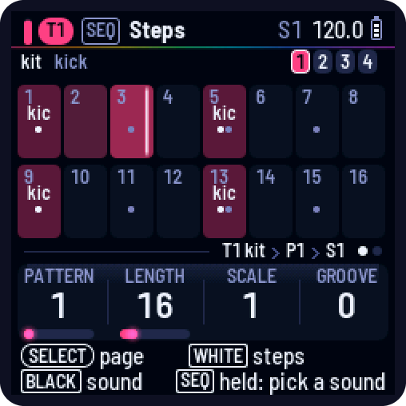
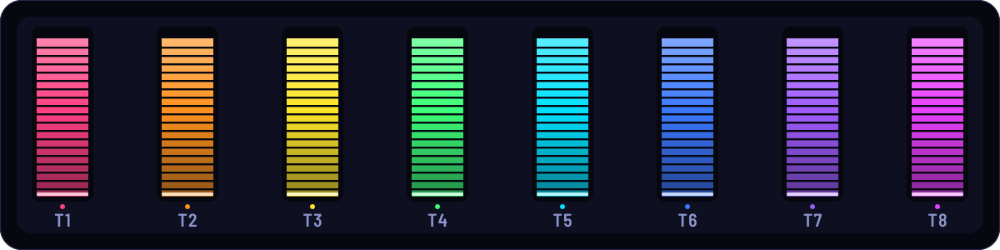
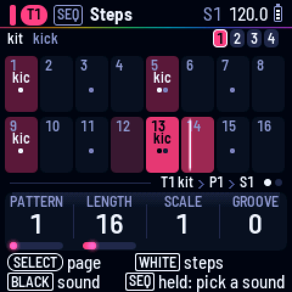
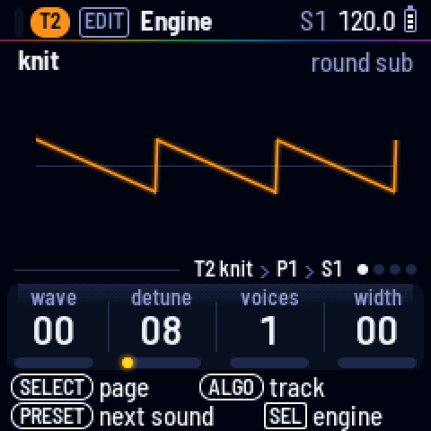
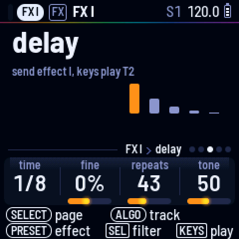
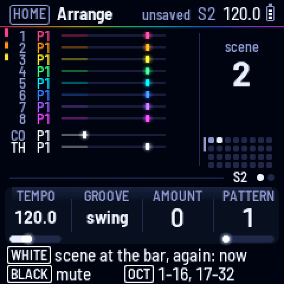

  

SoundPlant is a fork of LOOM-8 by Charles Vestal (https://github.com/charlesvestal/fm1-loom)

  
  
  
  

SoundPlant turns the M-VAVE FM-1 into a pocket groovebox: eight instrument tracks, each in its own colour, on eleven
engines and 93 factory presets, with a 64-step sequencer, a conductor that moves the song through a progression,
scenes and a song, and MIDI over USB, Bluetooth and the TRS jack. It is built on
[fm1-base](https://github.com/charlesvestal/fm1-base) and [felucca-bsp](https://github.com/hugelton/felucca-bsp),
from [Felucca](https://github.com/hugelton/Felucca) by Leo Kuroshita (Hügelton Instruments), with X0X's sequencer
discipline and Polly's menu paradigm.

## See it run

<table>
  <tr>
    <td valign="middle" width="360">
      
    </td>
    <td valign="middle">
      <b>The real firmware, on its own screen.</b> 
      This clip is captured from the host build of the firmware, not mocked up. A kick pattern plays under the
      playhead on the Steps page, then the Character, Envelope and Engine pages go by.  
      No FM-1 at hand? <a href="https://daemon-summoner.github.io/fm1-soundplant/emu/">Try it in your browser</a>,
      or read the <a href="docs/MANUAL.md">manual</a>: a ten-minute quick start, every page and gesture, and
      screenshots.
    </td>
  </tr>
</table>

  

## What is in it

<table>
  <tr>
    <td valign="top" width="33%">
       
      Eight instrument tracks, each in its own colour, with 93 factory presets to start from.
    </td>
    <td valign="top" width="33%">
       
      Seven synths (knit, rayon, jacquard, bellows, cane, voile and acid, a TB-303), a sample player, a break
      slicer, a drum kit, and MIDI out to drive another synth.
    </td>
    <td valign="top" width="33%">
       
      Up to 64 steps, with step tricks and parameter locks.
    </td>
  </tr>
  <tr>
    <td valign="top">
       
      Arp, strum and hold.
    </td>
    <td valign="top">
       
      Crosses two patterns: bar by bar, step by step, or one's rhythm with the other's notes.
    </td>
    <td valign="top">
       
      Momentary effects, thrown in while the pattern plays.
    </td>
  </tr>
  <tr>
    <td valign="top">
       
      A track that moves the song through a progression.
    </td>
    <td valign="top">
       
      Two send-effect tracks (the reverb has the PlayStation's reverbs among its modes), a mixer with EQ, and a
      compressor on the master.
    </td>
    <td valign="top">
       
      Scenes, and a song to put them in order.
    </td>
  </tr>
  <tr>
    <td valign="top">
       
      MIDI over USB, Bluetooth and the TRS jack, and as a USB MIDI host for a keyboard or synth (through a powered
      hub).
    </td>
    <td valign="top">
       
      Your projects and presets can be backed up to a computer and put back (the site's
      <a href="https://daemon-summoner.github.io/fm1-soundplant/backup/">Backup page</a>), and the screen mirrored
      to it and played from there (the <a href="https://daemon-summoner.github.io/fm1-soundplant/mirror/">Mirror page</a>).
    </td>
    <td valign="top">
       
      Your own samples load from their WAV files with <code>tools/soundplant_samples.py</code> (see the manual), or
      on the <a href="https://daemon-summoner.github.io/fm1-soundplant/samples/">Samples page</a>.
    </td>
  </tr>
</table>

## Screens

Real screens from the manual, one per kind of page.

<table>
  <tr>
    <td align="center" valign="top" width="25%">
       
      Steps, playing
    </td>
    <td align="center" valign="top" width="25%">
       
      Engine: knit
    </td>
    <td align="center" valign="top" width="25%">
       
      FX I: delay
    </td>
    <td align="center" valign="top" width="25%">
       
      Arrange: scene 2
    </td>
  </tr>
</table>

  

## Install

- **Install it** (Chrome or Edge, with the FM-1 plugged in): <https://daemon-summoner.github.io/fm1-soundplant/install/>
- **Download the firmware file**: [releases](https://github.com/daemon-summoner/fm1-soundplant/releases)
- **Try it in your browser** (no FM-1 needed): <https://daemon-summoner.github.io/fm1-soundplant/emu/>
- **Read the manual**: [docs/MANUAL.md](docs/MANUAL.md), with a ten-minute quick start, every page and gesture, and screenshots

Installing is at your own risk, though it's hard to get stuck: the web installer can put M-VAVE's
firmware back, and an FM-1 that keeps crashing starts in a safe mode.

The design is in `docs/superpowers/specs/2026-10-15-xy1-design.md`.

## Building and testing

SoundPlant is an app (`app/`) on fm1-base, a git submodule (`base/`): clone with `--recursive`. See `BUILDING.md`.
`tests/run_tests.sh` runs everything on the host, silently (the audio goes to WAV files). `LICENSING.md` says
where the code comes from. SoundPlant is GPL-3.0-only as a whole (`COPYING`), for its acid engine and 909 models; most of its files are
MPL-2.0 (`LICENSE`), each on its own.

## Credits

Who made what SoundPlant is built on

 

The platform: fm1-base and felucca-bsp (MPL-2.0), from Felucca by Leo Kuroshita (Hügelton Instruments), with his
permission (felucca-bsp#4). cane and voile: Mutable Instruments Braids by Emilie Gillet (MIT). acid: X0X's 303, from Open303 by Robin Schmidt (MIT), with jc303's Devilfish ranges by midilab (GPL-3.0) and dm-Rat's RAT drive by Dave Mollen (GPL-3.0). The reverb's PlayStation modes: PSXVerb (MIT). The x drums: after MACHINEDRUM by Omodaka9375 (MIT); sophie: Sophie by Matt Estela (MIT); clang: digisophie (MIT). The factory breaks: free loops by u/FCTRYBEATS,
with their permission; the plate reverb and the 909 kick, snare and clap: 9W9 by athousanddetails, under MPL-2.0 with his permission; the 909 kit models: 9W9's circuits by athousanddetails (GPL-3.0); the acid engine's and the 909 sampler's speed-ups: Optimist (GPL-3.0); the 909 hat: ER-99's sample by Matthew Cieplak, through 9W9 (GPL-3.0, in the sound bank only); the 909 cymbals (hat, open hat, ride, crash): ER-99's samples by Matthew Cieplak, through 9W9, played by 9W9's sampler (GPL-3.0, in the resource region beside the firmware); the recorded instruments: Versilian Studios Chamber
Orchestra 2 Community Edition (CC0). The fonts: Barlow and Terminus (SIL OFL 1.1). The second core's lessons: Melodee (keremimo) and Jangada (zednaked). The USB MIDI host: Melodee's, by Adrien Tibi and Kerem Kilic (MPL-2.0, in felucca-bsp).
Bluetooth MIDI and Bluetooth audio: Optimist's own stack by Henri David (MPL-2.0, in fm1-base), with Android's SBC
encoder (Apache-2.0) and micro-ecc by Kenneth MacKay (BSD-2-Clause); the radio's start-up tables and calibration
after JieLi's AC79 SDK (Apache-2.0).
The idea of a browser emulator: Groove OS.

SoundPlant's way of working owes a great deal to teenage engineering's OP-XY; SoundPlant is not affiliated with
teenage engineering.

How this page is made

 

The art on this page is generated, not drawn. `tools/make_readme_art.py` (Python standard library, plus Pillow for the
demo clip) writes `docs/img/readme-*`, and every motion in it comes from a small physics simulation that the script
samples into SVG animation keyframes. The plants are cantilever beams with two bending modes, and a pluck travels
along them and bounces back; the letters drop under gravity and squash on each impact; the meters ride damped springs,
their peak caps falling under gravity; the knobs and buttons use the same critically damped spring as the firmware's
screen. The text is outlined glyph paths from the Barlow fonts in `base/assets/fonts/`, so nothing is loaded from
outside, and there is no script in any of it.

Regenerate with `python3 tools/make_readme_art.py`. The demo clip is built from the frames of a host-simulator run
(`python3 tools/make_readme_art.py --demo FRAMES_DIR`, 184 PNGs named `f000.png` on). `tests/host/readme_test.py`
checks that the committed art is what the script writes, and that the links and the one credit to the name SoundPlant
was forked from are in order.

